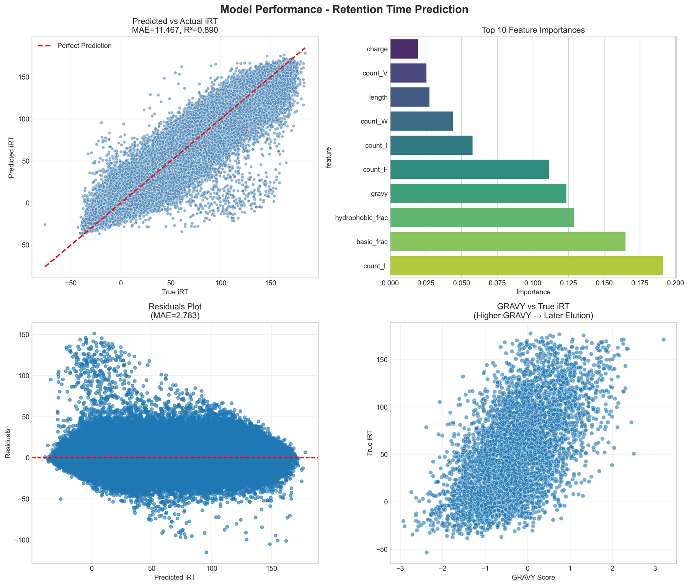

# Peptide Retention Time Prediction

Developed in the proteomics project course of **Prof. Mathias Wilhelm's Computational Mass Spectrometry group**, Technical University of Munich (January 2026), as part of the group's retention time prediction challenge.

The task: predict the liquid chromatography retention time of **73,782 peptides** measured on different mass spectrometry runs, from the peptide sequence alone. My model reached a **mean absolute error of 2.78 minutes** on the challenge test set.

<!-- TODO: add the challenge link (Hugging Face) here -->

## Approach

A simple, interpretable two-stage model instead of a large neural network:

```
peptide sequence ──► 26 physicochemical features ──► ExtraTrees ──► iRT ──► per-run linear calibration ──► retention time
```

1. **Features (26):** length, GRAVY hydropathy score, net charge, fraction of hydrophobic, basic and acidic residues, and the counts of all 20 amino acids. Modifications are stripped from the sequence.
2. **Stage 1, sequence → iRT:** an ExtraTrees regressor (600 trees) predicts the *indexed* retention time (iRT), which is independent of the instrument and gradient.
3. **Stage 2, iRT → RT:** for every instrument run (`raw_file`), a linear regression maps predicted iRT to the measured retention time (RT = m · iRT + b). Runs never seen in training fall back to the predicted iRT.

Splitting the problem this way lets the tree model learn chemistry once, while the cheap linear step absorbs the differences between instruments.

## Results

| | Value |
|---|---|
| Challenge score (MAE, retention time) | **2.78 min** |
| iRT model, validation R² | 0.890 |
| Peptides predicted | 73,782 |



The most important features are leucine count, the fraction of basic residues, hydrophobicity and phenylalanine count. This matches the chemistry of reversed-phase chromatography: hydrophobic peptides bind longer to the column and elute later.

A short write-up of the solution is in [`docs/solution_report.pdf`](docs/solution_report.pdf).

## Usage

```bash
pip install -r requirements.txt
python src/predict_rt.py --train data/train.csv --predict data/for_prediction.csv --out submission.csv
```

The challenge data is not included in this repository.

## Author

Silja Ohlsen, B.Sc. Bioinformatics, TUM & LMU Munich
